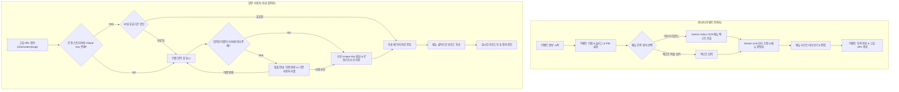

# ShortVotes 프로젝트 목표 정의서 (GOAL.md)

## 1. 프로젝트 개요 (Overview)
**ShortVotes**는 회식, 동아리 모임, 팀 워크숍, 간이 행사 등 며칠 내 신속하게 완료되어야 하는 임시성 단기 이벤트에서 카페 메뉴 선정, 간식 선택, 점심 메뉴 투표, 선호 항목 조사를 가장 빠르고 간편하게 완료할 수 있도록 설계된 **초경량 무인증 선호조사/투표 웹 시스템**입니다.

복잡한 계정 생성, 소셜 로그인, 휴대폰 본인인증 등의 불필요한 장벽을 완전히 제거하고, **"사용자 이름"**과 브라우저 **"Local Storage 기반 고유 키(Unique Key)"**의 2단계 조합으로 100명 내외 규모의 참여자를 안전하고 효율적으로 식별합니다.

관리자는 카페 메뉴판 사진(영수증/메뉴판)을 업로드하거나 메뉴 텍스트를 붙여넣기만 하면, **Google Gemini 2.5 Flash LLM**의 멀티모달 OCR 및 텍스트 교정 기능을 통해 단 몇 초 만에 메뉴 목록을 정제하여 투표 항목으로 등록할 수 있습니다.

---

## 2. 프로젝트 목적 (Purpose)

1. **무인증 기반의 극대화된 사용자 편의성 (Zero Friction)**
   - 회원가입/로그인 없이 이름 입력 한 번으로 투표 참여.
   - 브라우저의 Local Storage에 시스템 발급 Unique Key를 저장하여 재방문 시 자동 동일인 판별.
   - 약 100명 내외의 단기 참여자 규모에 최적화된 가벼운 세션 및 식별 체계 제공.

2. **Gemini LLM 기반의 지능형 메뉴 자동 등록 (Smart Menu Extraction)**
   - 카페 메뉴판, 메뉴 전단지, 손글씨 영수증 등의 이미지를 업로드하면 Gemini OCR을 통해 텍스트를 추출.
   - 오탈자 교정, 카테고리/가격/이름 정제, 기존 등록 메뉴와의 유사도 검토를 거쳐 사용자에게 프리뷰 제공 후 원클릭 등록.
   - 단순 텍스트 나열 입력 시에도 AI가 메뉴 리스트로 자동 정형화.

3. **신속한 이벤트 개설 및 공유 (Instant Event Setup & Sharing)**
   - 핀코드(PIN) 기반의 간단한 관리자 보안.
   - 사용자 맞춤형 URL 슬러그(예: `/shortvotes/friday-coffee`) 또는 자동 무작위 슬러그 발급.
   - 단일 링크 배포로 단체 채팅방, 사내 메신저, QR 코드를 통한 즉시 참여 지원.

4. **신뢰할 수 있는 사용자 충돌 방지 및 만료 정책 (Identity & Expiration Policy)**
   - 브라우저에 Unique Key가 없는 상태에서 기존 서버에 등록된 이름을 입력했을 때, "새로운 이름으로 변경" 또는 "기존 사용자 정보 리셋 후 재등록"을 선택할 수 있는 사용자 충돌 해결 프로세스 구현.
   - 1개월(30일) 경과 시 Unique Key 자동 만료 처리로 임시 데이터 관리의 안전성 확보.

---

## 3. 핵심 목표 (Key Objectives)

| 영역 | 핵심 목표 | 세부 내역 |
| :--- | :--- | :--- |
| **Backend** | Python FastAPI 기반 고성능/경량 API 서버 | • 포트: `5000` • URL Base Prefix: `/shortvotes` • 동시 접속 100명 내외에 최적화된 경량 DB(SQLite) |
| **AI 연동** | Gemini 2.5 Flash 멀티모달 & 텍스트 API | • `.env` 환경변수(`GEMINI_API_KEY`, `GEMINI_MODEL_NAME`, `GEMINI_API_MAX_TOKENS`) 연동 • 이미지 OCR 메뉴 추출 및 텍스트 오타 보정 JSON 구조화 |
| **Frontend** | 반응형 모바일 퍼스트 인터페이스 | • 별도 빌드 도구 없는 직관적 템플릿(Jinja2 + TailwindCSS CDN + Vanilla JS) • Local Storage 키 관리, 투표 인터랙션, 결과 차트 |
| **보안/식별** | LocalStorage Unique Key & PIN 보안 | • 4~6자리 PIN을 통한 이벤트 관리자 접근 제어 • 클라이언트 UUID 발급 및 30일 유효기간 관리 • 중복 이름 충돌 방지 다이얼로그 |
| **배포/운영** | 원클릭 실행 및 단일 패키지 구성 | • 가상환경 및 단일 uvicorn 명령어로 즉시 구동 가능한 환경 구성 |

---

## 4. 전체 구현 내역 요약 (Implementation Summary)

### 주요 컴포넌트 요약
1. **이벤트 관리 모듈 (`Event Manager`)**:
   - 고유 엔드포인트(Slug) 유효성 검증 및 생성 (미입력 시 6자리 영숫자 랜덤 생성).
   - 관리자 PIN 인증 및 세션 검증.
   - 이벤트 상태(진행 중, 마감) 및 만료 관리.

2. **Gemini AI 메뉴 파서 (`Gemini Menu Extractor`)**:
   - `google-genai` 또는 `google-generativeai` SDK를 통해 `.env` 환경변수 적용.
   - 이미지 OCR 프롬프트: 메뉴판 이미지에서 메뉴명, 가격(선택), 카테고리를 JSON 배열로 정형 추출.
   - 텍스트 오타 보정 프롬프트: 사용자가 대충 작성한 텍스트 또는 OCR 결과물을 한국어 표준 표기법 및 카페 메뉴 명칭 기반으로 교정.

3. **클라이언트 식별 및 세션 엔진 (`Client Identity Service`)**:
   - 브라우저 LocalStorage에 `shortvotes_user_id` (UUID v4)와 `shortvotes_user_name`, `created_at` 저장.
   - 서버 DB와의 유효성 검증 및 30일 만료 여부 판별.
   - 이름 중복 감지 및 대화형 모달(Modal)을 통한 리셋 또는 이름 변경 지원.

4. **투표 & 선호도 조사 엔진 (`Voting Service`)**:
   - 참여자당 1인 1메뉴 선택 (또는 다중 선택 옵션 지원 구조).
   - 투표 내역 즉각 갱신 및 집계 (인기 메뉴 Top N, 참여자별 선택 내역).

---

## 5. 기대 효과 및 산출 가치
- **행사 운영 시간 단축**: 10~20분 이상 소요되던 단체 음료/식사 주문 및 투표 과정을 1~2분 이내로 단축.
- **오탈자 및 주문 실수 제로화**: Gemini LLM을 통한 메뉴명 자동 정제와 명확한 시각화로 주문 취합 실수 원천 차단.
- **극대화된 접근성**: 별도 앱 설치나 가입 없이 메신저 링크 클릭 한 번으로 모바일 브라우저에서 즉시 완료.
